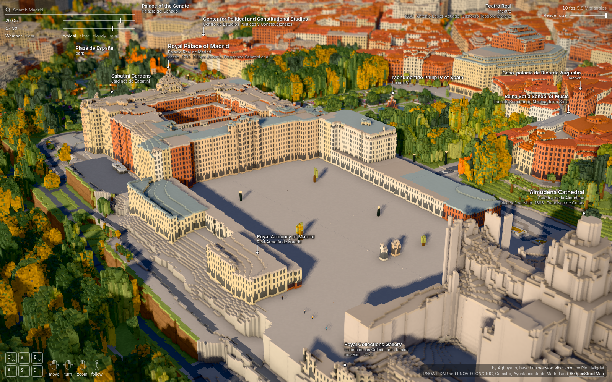
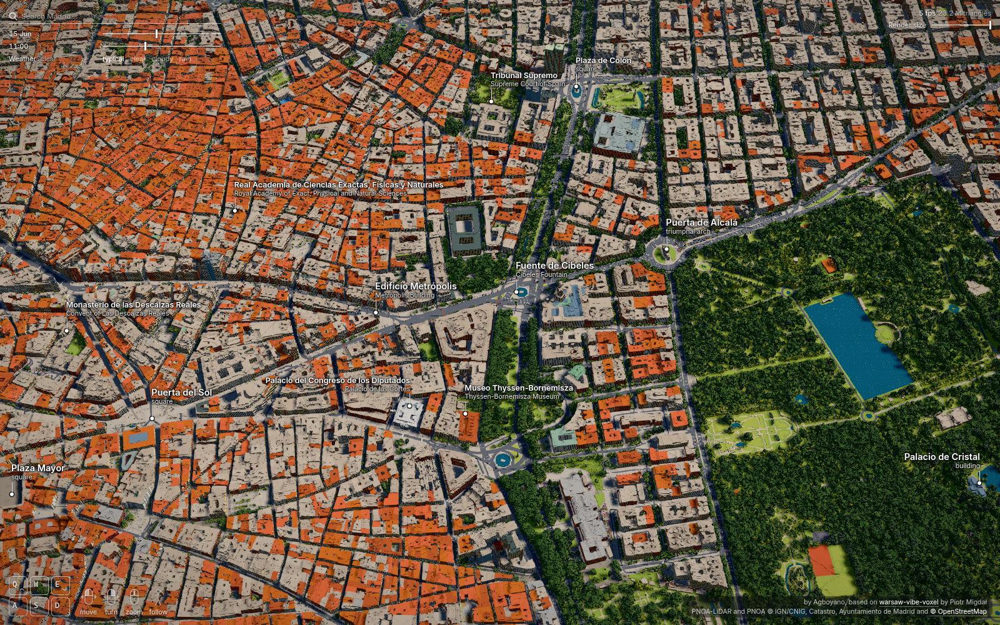
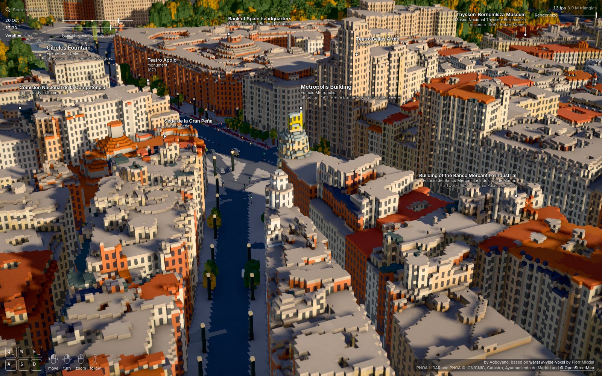
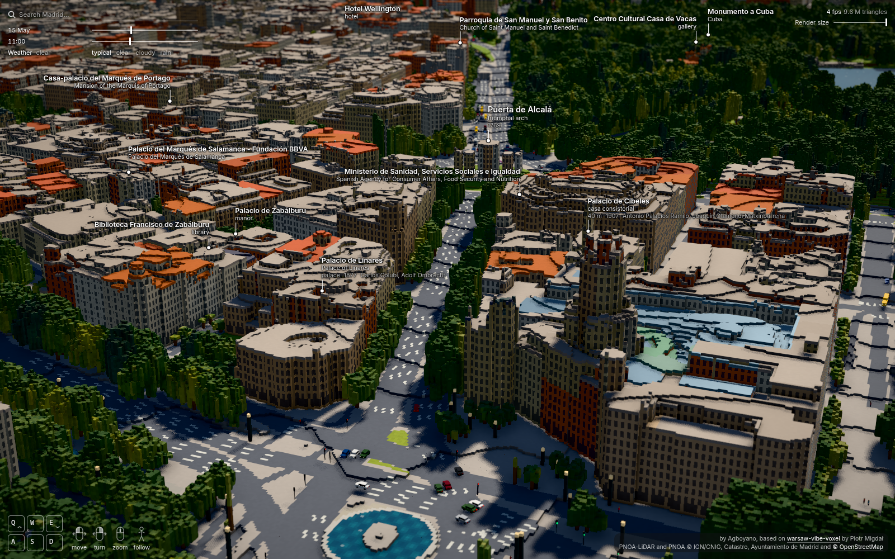
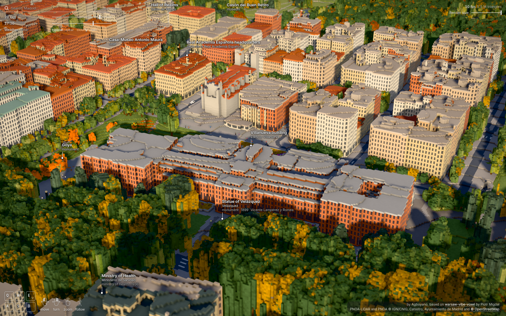

# Madrid in voxels

An interactive 3D map of central Madrid in 1 m voxels, running in the browser as a static site: from the Templo de Debod and Plaza de España past the Retiro to Calle del Doctor Esquerdo, and from Glorieta de Bilbao and Manuel Becerra to Atocha (4.4 × 2.85 km). Change the date, the hour and the weather, follow a pedestrian or a car, and open a landmark's card for its history.

**Live: [agboyano.github.io/madrid-voxel](https://agboyano.github.io/madrid-voxel/)**



| | |
| --- | --- |
|  |  |
|  |  |

It is a port of [warsaw-vibe-voxel](https://github.com/stared/warsaw-vibe-voxel) by Piotr Migdał, with pieces adapted from [dtla-voxel](https://github.com/sigman78/dtla-voxel) by sigman78.

## Run the viewer

```sh
cd web
npx -y pnpm@12.11.2 install --frozen-lockfile
npx -y pnpm@12.11.2 exec vite          # http://localhost:5173/?view=palace&date=10-20&hour=17.5
```

URL parameters:
- `view`: one of `overview`, `sol`, `palace`, `plazamayor`, `granvia`, `cibeles`, `prado`, `top`, `street`;
- `cam=px,py,pz,tx,ty,tz`: a camera position and target in voxel coordinates;
- `date=M-D`, `hour`, `weather` (`clear`, `cloudy`, `rain`, `snow`);
- `ui=0` hides the interface; `tilt=0` disables the tilt-shift effect.

The generated data is in the repository (`web/public/data`, 32 MB), so the viewer runs without building anything.

### Controls

Three modes: the bird's-eye view, on foot, and following a pedestrian, car or tram (click or tap one).

| | Mouse and keyboard | Touch | Gamepad |
| --- | --- | --- | --- |
| Move (air) | drag; W/S fly along the view | drag | left stick; LT/RT down and up |
| Turn and tilt (air) | right-drag; A/D, Q/E | two fingers | right stick |
| Zoom (air) | wheel | pinch | left stick forward |
| Down to the street | zoom onto it, or double-click | **Walk here** | A |
| Walk | W/S, A/D turn; click a spot | the stick; tap a spot | left stick (also sideways); RT runs |
| Look around | drag | drag | right stick |
| Jump | Space | **Jump** | A |
| Back up to the air | Esc, or keep scrolling back | **Fly up** | B |
| Hour | the slider | the slider | LB / RB, an hour back or on |

Touch controls appear only on touch screens, and the gamepad legend replaces the keyboard's once a gamepad is connected (press any of its buttons first: browsers only expose a gamepad after a press).

## Build the data

```sh
uv sync
sh scripts/build_data.sh        # ~20 min for the full area the first time, from cached downloads after that
```

Every download goes to a cache outside the repository, `$MADRID_CACHE` (default `~/data/madrid-voxel-cache`), and is never fetched twice. The area to build is set in `pipeline.toml`:
- `[aoi] area`: `full` (the whole map) or `sol` (500 m around Puerta del Sol, builds in under a minute);
- `MADRID_AREA=<name>` in the environment overrides it.

The **PNOA-LiDAR** point cloud cannot be downloaded automatically, because the CNIG download centre asks for a reCAPTCHA. `PYTHONPATH=scripts uv run python scripts/fetch_pnoa_lidar.py` lists the 1 km tiles the area needs, with their file names, and checks the files once they are in `$MADRID_CACHE/raw/pnoa_lidar/`. The full area needs 24 tiles.

The full build peaks at about 16 GB of memory, in `voxelize.py`. `scripts/build_data.sh` prints each step's time and peak memory.

## How it is made

| Step | Script | What it does |
| --- | --- | --- |
| Downloads | `fetch_*.py` | OSM (Overpass), Catastro buildings (INSPIRE WFS), the municipal tree inventory, the PNOA orthophoto (WMS), Wikidata facts, all cut to the area |
| Point cloud | `prep_lidar.py` | rasterises the classified PNOA-LiDAR cloud straight onto the map's grid: surface, ground, class, counts (the common elevation format: another flight only needs a new adapter) |
| Rasters | `prep.py` | the surface, terrain and orthophoto on the grid |
| Fusion | `layers.py` | ground, streets, buildings and roofs as 2D layers |
| Voxels | `voxelize.py` | the 3D city: buildings with their roofs and windows, trees, street furniture, bridge decks, underpasses; then the tiles |
| Viewer data | `terrain.py`, `zones.py`, `windows.py`, `places.py`, `phenology.py`, `climate.py` | first-moment terrain, city blocks, lit windows, the search index, the seasonal cycle of each tree, the weather of each day |

The main rules:
- **Buildings:** OSM footprints with heights from the LiDAR. Catastro gives the floor count where OSM has none, and adds the buildings OSM lacks. Where the LiDAR sees nothing tall, the OSM or Catastro height wins (a building finished after the flight).
- **Trees:** the Ayuntamiento's inventory, about 43 000 trees with species and height. A tree whose crown the leaf-off LiDAR flight did not catch is drawn young, at its inventory height. Each tree turns with the season of its genus.
- **Roofs:** clay tile, slate, zinc or flat terrace, chosen from the orthophoto; walls in Madrid's render and brick, with Madrid de los Austrias in its own colours.
- **Labels:** found through the `wikidata` tag of OSM features, never by name. They show the Spanish name, as on the street signs, with the English one under it where it differs. The cards carry the year built, architect, height, style, heritage designation and links, all written at build time.

`NOTES.md` has the technical notes, `DECISIONS.md` the decisions and their reasons, `PLAN.md` the plan the work followed and `todo.md` what is left.

## Known limitations

- **One LiDAR flight, in March:** the PNOA flight of 17–18 March 2024 was leaf-off, so deciduous crowns are sparse. Trees without a crown are drawn young from the inventory; private trees outside it take their crown from the LiDAR alone.
- **Older orthophoto:** the most recent PNOA orthophoto (July 2023) is a year older than the LiDAR and is not a true orthophoto, so the roofs of tall buildings lean slightly off their footprints.
- **1 m voxels:** pitched roofs become 1 m terraces, cornices and eaves make facades ragged, and street furniture taller than 1.5 m shows as grey blocks.
- **Grid at −6°:** the grid follows the Ensanche of the Barrio de Salamanca, which covers most of the map. Streets at other angles show a staircase along their facades: Gran Vía, the Paseo del Prado and the irregular streets of the historic centre.
- **Landmarks are not curated:** the Royal Palace's parts take generic wall colours, and no landmark has hand-made details yet (`scripts/overrides.json` and `landmarks.py` hold the tools).
- **Seasons with gaps:** Styphnolobium, the horse chestnut and the chinaberry, and the leaf-out of hackberries and limes, take the median dates of the other trees: iNaturalist has too few observations of them in Mediterranean climates (`todo.md` has the satellite source that would measure them in Madrid). Lit-window habits and the traffic model come from Warsaw's measurements.
- **Data gaps:** four 31 m squares of Catastro building parts near Calle de Toledo could not be downloaded (the service fails on it).

## Sources

Data the map is built from:
- **PNOA-LiDAR, 3rd coverage (NPC02)** and **PNOA orthophoto**: © [Instituto Geográfico Nacional](https://www.ign.es/), from the [Centro de Descargas del CNIG](https://centrodedescargas.cnig.es/) and the IGN's WMS, under [CC BY 4.0](https://creativecommons.org/licenses/by/4.0/).
- **[OpenStreetMap](https://www.openstreetmap.org/)**: © OpenStreetMap contributors, under the [ODbL](https://opendatacommons.org/licenses/odbl/), via the Overpass API.
- **Catastro**: buildings from the INSPIRE service of the Dirección General del Catastro ([sede.catastro.gob.es](https://www.sedecatastro.gob.es/)). Source: Dirección General del Catastro.
- **Tree inventory**: "Arbolado en parques y zonas verdes de Madrid (detalle)", Ayuntamiento de Madrid, [datos.madrid.es](https://datos.madrid.es/), under [CC BY 4.0](https://creativecommons.org/licenses/by/4.0/).
- **[Wikidata](https://www.wikidata.org/)**: landmark names and facts, [CC0](https://creativecommons.org/publicdomain/zero/1.0/).
- **[Open-Meteo](https://open-meteo.com/)**: the ERA5 historical weather archive, under [CC BY 4.0](https://creativecommons.org/licenses/by/4.0/), for how likely each kind of weather is on each day.
- **[iNaturalist](https://www.inaturalist.org/)**: leaf annotations of observations in regions with Madrid's climate (Spain, Portugal, Italy, Greece, southern France, Cyprus, Turkey, Israel, Lebanon, the Maghreb, California), aggregated by week, for when each genus leafs out and colours.
- **[Copernicus Sentinel-2](https://sentinel.esa.int/web/sentinel/missions/sentinel-2)** L2A, 2022–2024, through the [Microsoft Planetary Computer](https://planetarycomputer.microsoft.com/): contains modified Copernicus Sentinel data, for the colour of irrigated lawns and dry meadows through the year.
- **Pollen**: the Ayuntamiento de Madrid's report on airborne pollen in central Madrid (2023–2024), as a check on the plane trees' leaf-out.
- **[Wikimedia Commons](https://commons.wikimedia.org/)**: photos measured for autumn and lawn colours and lit windows (`scripts/foliage_photos.json`, `scripts/grass_photos.json`, `scripts/window_counts.json`; Warsaw's from warsaw-vibe-voxel, and Madrid's own for plane trees, Styphnolobium, elms, hackberries, chinaberries and the purple-leaved plum).

Software:
- **Viewer:** [three.js](https://threejs.org/), [postprocessing](https://github.com/pmndrs/postprocessing), [N8AO](https://github.com/N8python/n8ao) and [Vite](https://vite.dev/).
- **Pipeline:** [NumPy](https://numpy.org/), [SciPy](https://scipy.org/), [Shapely](https://shapely.readthedocs.io/), [rasterio](https://rasterio.readthedocs.io/), [pyproj](https://pyproj4.github.io/pyproj/), [laspy](https://laspy.readthedocs.io/) and [Pillow](https://python-pillow.org/).
- **Screenshots and profiling:** [Playwright](https://playwright.dev/).

## Credits and licences

- **This project:** the Madrid port's own code is under the MIT licence, in [LICENSE](LICENSE). It covers the code only; the generated data keeps the licences of its sources (below).
- **Original project:** [warsaw-vibe-voxel](https://github.com/stared/warsaw-vibe-voxel) by Piotr Migdał. The viewer, the tile format and most of the fusion rules come from it. MIT licence, kept in [LICENSE-warsaw-vibe-voxel](LICENSE-warsaw-vibe-voxel).
- **Los Angeles port:** [dtla-voxel](https://github.com/sigman78/dtla-voxel) by sigman78. The point-cloud rasterisation, the area helpers, the downloads by area, the crossings and the structure of the 2D layers are adapted from it. MIT licence, kept in [LICENSE-dtla-voxel](LICENSE-dtla-voxel).
- **Generated data** in `web/public/data` derives from the sources above: OpenStreetMap (ODbL), IGN/CNIG (CC BY 4.0), the Ayuntamiento de Madrid (CC BY 4.0), Catastro and Wikidata (CC0).
